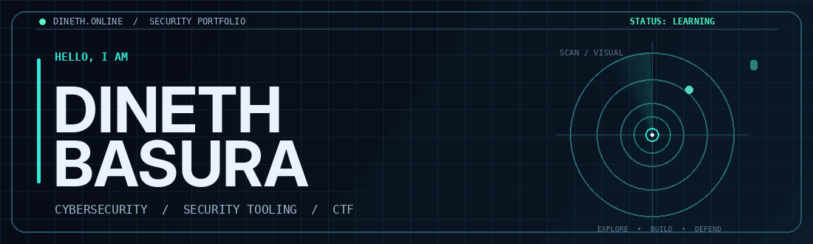
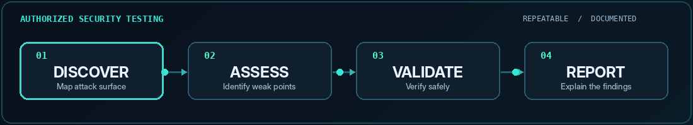

 

 

## Hey, I'm Dineth 👋

I'm a **cybersecurity undergraduate at SLIIT**, based in Sri Lanka, with a strong interest in **web application penetration testing, security automation, and practical security engineering**. I learn by building real projects, exploring vulnerable labs, and turning technical findings into usable reports.

- 🔍 **Focused on:** Web security · Vulnerability assessment · CTFs · Network security
- ⚙️ **Building toward:** Automated web security testing with a GUI and actionable reporting
- 🎯 **My approach:** Understand the weakness → validate safely → document evidence → suggest fixes

### Security workflow

  

Testing is limited to my own environments, labs, and systems where I have explicit authorization.

## Tools I work with

**Security & systems**

**Development & automation**

## Selected projects

| Project | What I built / explored |
| :--- | :--- |
| 🛡️ **[Meridian Transfer — CTF Platform](https://github.com/Dineth-Basura/meridian-transfer-ctf-platform)** | Team-based security training environment with challenges involving OSINT, steganography, cryptography, web security, forensics, and scripting. |
| 🚘 **[PlateX — AI License Plate Recognition](https://github.com/Dineth-Basura/PlateX-AI-License-Plate-Detection-Recognition-System)** | Computer vision project exploring license plate detection and recognition. |
| 🌍 **[RescuePulse](https://github.com/Dineth-Basura/RescuePulse)** | Disaster prediction research project created for WSO2 Innovate with Ballerina 2025. |

### What I'm exploring next

**A GUI-based web application vulnerability assessment tool** — a project in planning/development. The goal is to combine authorized testing, reproducible findings, and clear report generation in one practical interface.

## Learning & credentials

- **Fortinet NSE 2** — completed training
- **Cisco Introduction to Cybersecurity** — course completion
- **Qualys VMDR** — vulnerability-management learning
- **ISO/IEC 27001** — foundational ISMS study

---

**Curiosity → Practice → Evidence → Improvement**

<a href="https://dineth.online/"><strong>Explore my portfolio</strong></a> · <a href="https://github.com/Dineth-Basura?tab=repositories"><strong>View my repositories</strong></a>

Built with curiosity · Learning in public · Testing responsibly

